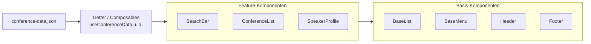
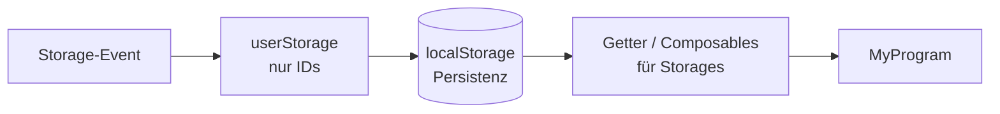
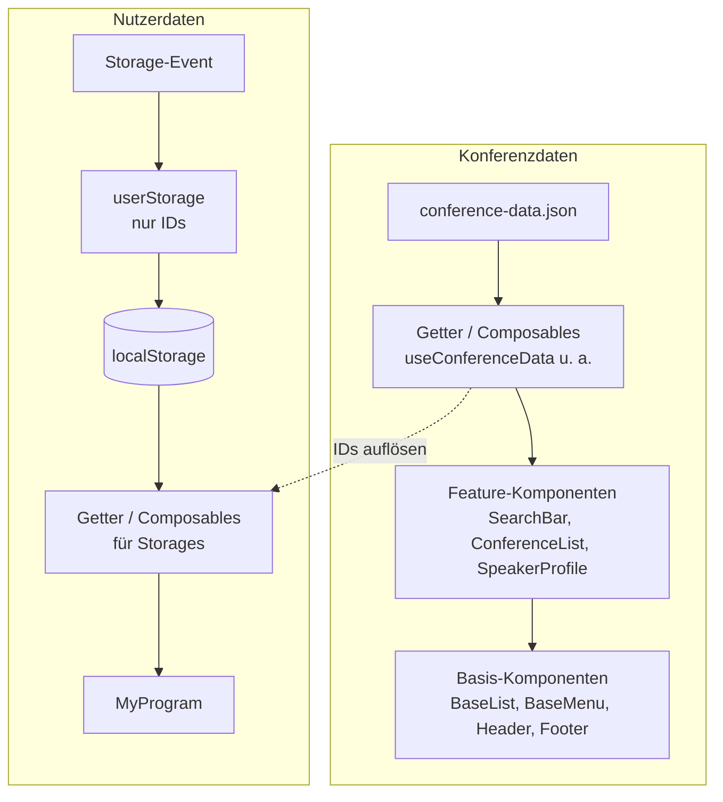

**Prompt:** Kannst du mir bitte auf der Basis unserer definierten Fabrben und Anwendung eine Überischts Strukturieren und schön formatieren? Primary: #850c54 Hauptfarbe, auch für Übershcriften und CTA.
Secondary: #da148a #30041e für Tags und akzentelemente 
Structur Colors:  Hintergrudnkartenfarbe: #dedede Hintergrund Light und Textfarbe #ffffff Textfarbe dunkel: #2d2d2d Darkmode: #212121 
Text Colors: #cccccc #ffffff #2d2d2d 
**Antwort:** * `color-surface-base`: Basis-Hintergrund der App (`#ffffff` im Light Mode, `#212121` im Dark Mode).
* `color-surface-card`: Hintergrund für Karten und Container (`#dedede` im Light Mode, `#2d2d2d` im Dark Mode).
* `color-brand-primary`: Primäre Markenfarbe für Hauptelemente und CTAs (`#850c54` Deep Berry).
* `color-brand-secondary`: Sekundäre Akzentfarbe (`#da148a`). C, Hoveromment: Für Hinweis
* `color-brand-accent`: Zusätzlicher Akzentton (`#30041e`). Comment: Für Tags,Active State
* `color-text-primary`: Haupttextfarbe (`#2d2d2d` im Light Mode, `#ffffff` im Dark Mode).
* `color-text-on-brand`: Textfarbe auf Markenelementen (`#ffffff`)

**Prompt:** Kannst du mir bitte auf Basis von den offizielle W3C Design Tokens Format die Json Struktur ausgeben für die Design Tokens?
**Antwort:** {
  "color": {
    "brand": {
      "primary": {
        "$value": "#850c54",
        "$type": "color",
        "$description": "Primary / Basecolor Deep Berry"
      },
      "secondary": {
        "$value": "#da148a",
        "$type": "color",
        "$description": "Secondary Accent Hot Magenta"
      },
      "accent": {
        "$value": "#30041e",
        "$type": "color",
        "$description": "Dark Aubergine Accent"
      }
    },
    "neutral": {
      "0": {
        "$value": "#ffffff",
        "$type": "color",
        "$description": "Pure White / Light Background"
      },
      "300": {
        "$value": "#cccccc",
        "$type": "color",
        "$description": "Card Background Light Mode"
      },
      "800": {
        "$value": "#2d2d2d",
        "$type": "color",
        "$description": "Text & Dark Mode Cards"
      },
      "900": {
        "$value": "#212121",
        "$type": "color",
        "$description": "Dark Mode Background"
      }
    },
    "surface": {
      "base": {
        "$value": "{color.neutral.0}",
        "$type": "color",
        "$description": "Main background surface in light mode (dynamic for dark mode)"
      },
      "card": {
        "$value": "{color.neutral.300}",
        "$type": "color",
        "$description": "Card background surface in light mode"
      }
    },
    "text": {
      "primary": {
        "$value": "{color.neutral.800}",
        "$type": "color",
        "$description": "Primary text color in light mode"
      },
      "onBrand": {
        "$value": "{color.neutral.0}",
        "$type": "color",
        "$description": "Text color on brand elements"
      }
    }
  },
  "spacing": {
    "xs": {
      "$value": "0.25rem",
      "$type": "dimension"
    },
    "sm": {
      "$value": "0.5rem",
      "$type": "dimension"
    },
    "md": {
      "$value": "1rem",
      "$type": "dimension"
    },
    "lg": {
      "$value": "1.5rem",
      "$type": "dimension"
    },
    "xl": {
      "$value": "2.5rem",
      "$type": "dimension"
    }
  },
  "typography": {
    "fontSize": {
      "sm": {
        "$value": "0.875rem",
        "$type": "dimension"
      },
      "base": {
        "$value": "1rem",
        "$type": "dimension"
      },
      "lg": {
        "$value": "1.25rem",
        "$type": "dimension"
      },
      "xl": {
        "$value": "2rem",
        "$type": "dimension"
      },
      "xxl": {
        "$value": "3rem",
        "$type": "dimension"
      }
    }
  }
}

**Prompt:** Kannst du mir auf Basis unserer Notizen eine Zusammenfassung geben und formatieren? Notizen: vue weil wir es können 
vite als programm rapper 
router 
weil ide erfahrung im team höher ist
wir wissen nciht ob wir routing brauchen und in nuxt ist es standardmäßig drinnen wir wissen es noch nicht geanu deshalb ist eine modulare technologie und entshceidne können was wir reingen macht da srpojekt angenehmer und agiler

Nur die Setup-/Tooling-Entscheidung  warum wir es so gemacht haben in dem sinne - set up auf git hub website pubishen kann weil es einfahcer ist es simuleirt echte praxisnahme weil praxisnah links lklicken und keien command lein und workflow eigenes deployment scrpit url die auch nicht über den local host arbeiten müssen und auf github gehen und test pagesdeployment  
 **Antwort:** Hier ist dein maßgeschneidertes ADR-Dokument (Aufgabe D) für VibeConnect, das exakt auf eure gewählten Tools und eure Begründungen (modularer Ansatz, Flexibilität ohne erzwungenes Nuxt, realitätsnahes Deployment über GitHub Pages statt lokaler Konsole) zugeschnitten ist:

Markdown
# ADR-1027: Frontend-Architektur, Tooling & Deployment-Strategie für VibeConnect

## Status

Accepted / Implemented

## Datum

2026-10-18

## Kontext

Für die Entwicklung der VibeConnect Konferenz-App benötigen wir ein zukunftsfähiges, performantes und wartbares Frontend-Setup. Die Anforderungen umfassen eine schnelle Entwicklung, saubere State-Verwaltung für den personalisierten Timetable sowie eine realitätsnahe, kollaborative Test- und Präsentationsumgebung.

Im Team haben wir folgende Rahmenbedingungen evaluiert:
- **Framework-Wahl:** Wir haben Vorkenntnisse und praktische Erfahrung mit Vue.js im Team („weil wir es können“ bzw. das Team darin am sichersten ist).
- **Routing-Unsicherheit:** Zu Beginn des Projekts war nicht exakt definiert, ob eine komplexe Multi-View-Routing-Struktur zwingend erforderlich ist oder ob ein einfacher Ansatz reicht. Starre Full-Stack-Frameworks wie Nuxt erzwingen standardmäßig ein festes Routing-Konzept. Wir wollten uns jedoch die Freiheit bewahren, modular zu entscheiden und Features bedarfsorientiert hinzuzufügen, um das Projekt agiler zu halten.
- **Deployment & Präsentation:** Ein reines Ausführen auf dem lokalen Host (`localhost`) ist für Stakeholder-Präsentationen und praxisnahe Tests ungeeignet. Wir benötigten einen Weg, der echte Praxisnähe simuliert, ohne komplexe Command-Line-Deployment-Skripte aufsetzen zu müssen.

## Entscheidung

Wir treffen folgende technologische Entscheidungen für das Frontend-Setup von VibeConnect:

1. **Vue 3 (Composition API) als Kern-Framework:** Genutzt aufgrund der vorhandenen Team-Erfahrung und der hervorragenden Wartbarkeit.
2. **Vite als Build-Tool / Program-Wrapper:** Ersetzt traditionelle Bundler durch extrem schnelle HMR (Hot Module Replacement) und einen schlanken Entwicklungsprozess.
3. **Vue Router (modular eingebunden):** Obwohl wir anfangs flexibel bleiben wollten, binden wir den Router gezielt ein, um modular zu entscheiden, wann und wie viele Views wir benötigen – ohne den Overhead eines schwergewichtigen Frameworks.
4. **GitHub Pages für automatisches Deployment:** Wir publizieren die Website direkt über GitHub Pages. Dadurch erhalten wir eine echte, öffentlich erreichbare URL (ohne `localhost`), was reale Praxisnähe simuliert und ein unkompliziertes, fehlerfreies Testen per Klick ermöglicht.

## Betrachtete Alternativen

### Nuxt.js (Full-Stack Meta-Framework)
- Vorteile: Stark standardisiert, automatisches File-System-Routing, integriertes Server-Side Rendering (SSR).
- Nachteile: Erzwingt vordefinierte Strukturen (z. B. striktes Routing), was unseren agilen, modularen Ansatz zu Beginn eingeschränkt hätte, da wir noch nicht exakt wussten, ob wir den vollen Router-Umfang benötigen.
- Warum abgelehnt: Zu starr für unsere aktuelle Findungsphase; eine modulare Single-Page-Application (SPA) mit Vue + Vite gibt uns mehr Freiheit.

### Reines Lokales Hosting (Localhost / Manuelle ZIP-Verteilung)
- Vorteile: Keine externe Plattform-Anbindung nötig, komplett offline steuerbar.
- Nachteile: Keine echte Praxisnähe, umständlich für Team-Review und Präsentationen, erfordert immer das Starten über die Command Line beim Betrachter.
- Warum abgelehnt: GitHub Pages bietet uns ohne Mehraufwand eine echte Test-URL, die sich wie eine Live-App verhält.

## Konsequenzen

### Positiv
- **Hohe Entwicklungsgeschwindigkeit:** Das Team arbeitet mit vertrauten Technologien (Vue + Vite).
- **Agile Flexibilität:** Durch die modulare Einbindung entscheiden wir selbst, wann Routing-Komponenten aktiv werden, statt von einem Framework eingeschränkt zu werden.
- **Echte Praxisnähe (UX & Testing):** Die Live-URL auf GitHub Pages ermöglicht es, die App wie ein echtes Produkt zu bedienen, ohne Kommandozeilen-Hürden.
- **Geringer Overhead:** Keine komplexe CI/CD-Pipeline oder Server-Infrastruktur notwendig.

### Negativ / Herausforderungen
- Als reine Single-Page-Application (SPA) auf GitHub Pages müssen Client-Side-Routes (wie Deep Links) korrekt konfiguriert werden (z. B. via `404.html`-Fallback), damit beim Neuladen kein 404-Fehler entsteht.

### Risiken
- Bei zukünftigem Bedarf an Server-Side Rendering (SSR) oder SEO-Optimierungen für viele Unterseiten müsste das Setup migriert werden. Für eine Konferenz-App mit personalisiertem Timetable ist die aktuelle SPA-Architektur jedoch vollkommen ausreichend.

## Verwandte Entscheidungen

- Schritt 1: Design-Token-Architektur (W3C DTCG Format, Light/Dark Mode Vorbereitung)
- VibeConnect Konferenz-Daten-Integration (`conference-data.json`)

**Prompt:** Als nächstes folgt das State-managment konzept. Wie sollte die große conference-data.json geladen und modeliert werden? Sollten wir ganze Objekte oder nur IDs verwenden und wie synchronisieren wir das? Wie reaktiv sollten sich die Komponenten verhalten und wie läuft der Datenfluss ab?
**Antwort:** Ich würde zwischen zwei Arten von Daten trennen, weil sich daraus fast alle anderen Entscheidungen ergeben:

Konferenzdaten (Sessions, Speaker, Räume): groß, im Wesentlichen read-only, kommen aus der JSON bzw. API.
Nutzerzustand (Favoriten, eigener Zeitplan, Filter): klein, veränderlich, wird lokal persistiert.
1. Laden der großen JSON
Nicht ins Bundle importieren, sondern zur Laufzeit laden (fetch aus public/ oder von der API). Sonst wächst euer Hauptbundle und jede Datenänderung erfordert einen Build.
Einmal laden, in einem Store halten, mit Status (idle | loading | ready | error). Die Komponenten stoßen das Laden nicht selbst an, sondern der App-Start oder der Router-Guard.
Validieren und mappen in der API-Schicht: JSON → (z. B. mit Zod validiert) → Normalisierer → Domänenmodell. Komponenten sehen nie das Roh-JSON.
Cachen mit Stale-while-revalidate (z. B. ETag oder ein version-Feld in der JSON): Beim Start sofort die gecachten Daten zeigen, im Hintergrund prüfen, ob es neuere gibt.
2. Modellierung: normalisieren, Beziehungen per ID

Haltet jede Entität genau einmal und verweist über IDs darauf:

ts
interface ConferenceState {
  sessions: Record<string, Session>   // oder Map
  speakers: Record<string, Speaker>
  rooms: Record<string, Room>
  sessionIds: string[]                // Reihenfolge
}

interface Session {
  id: string
  title: string
  speakerIds: string[]   // Verweis, kein verschachteltes Objekt
  roomId: string
  start: string
  end: string
}

Ganze Objekte oder IDs? Beides, je nach Ort:

Im Store: Entitäten als ganze Objekte in Lookup-Maps, Beziehungen als IDs. Das vermeidet Duplikate und inkonsistente Kopien.
Im Nutzerzustand: ausschließlich IDs (favoriteSessionIds). Nie Objekte kopieren, sonst veralten sie bei jedem Daten-Update.
In den Komponenten: Props sind je nach Schicht unterschiedlich. Eine SessionCard bekommt eine sessionId und holt sich die Daten über ein Composable, oder ein aufgelöstes Objekt, wenn sie rein darstellend ist. Base-Komponenten bekommen nur primitive Werte.
Verknüpfte Daten (Session samt Speaker-Namen) entstehen erst in Getters bzw. Composables durch Auflösen der IDs, nicht beim Laden.
3. Synchronisierung
Einzige Wahrheit: Der Conference-Store ist von außen nur lesbar (readonly), geändert wird er nur durch load()/refresh(). Der User-Store enthält nur IDs und Einstellungen.
Persistenz nur für den User-Store, über useStorage (VueUse) oder ein Pinia-Persist-Plugin. Der gespeicherte Stand bekommt eine schemaVersion für spätere Migrationen.
Daten-Updates: Beim Refresh wird der normalisierte Zustand als Ganzes ersetzt. Danach bereinigt ihr verwaiste IDs im Nutzerzustand (z. B. eine Favoriten-Session, die es nicht mehr gibt).
Mehrere Tabs: useStorage synchronisiert über das storage-Event automatisch.
4. Reaktivität
Große Datenmengen flach halten: Die Maps in shallowRef (oder markRaw/Object.freeze für Read-only-Daten) statt tiefer Reaktivität. Das spart bei tausenden Objekten spürbar Speicher und Rechenzeit.
Aktualisieren durch Ersetzen, nicht durch Mutieren: state.value = newState.
Abgeleitetes per computed: Gefilterte Listen, “Sessions pro Tag” usw. sind Getter, nie gespeicherter Zustand.
Schmale Abos: Komponenten greifen auf kleine Ausschnitte zu (useSession(id), useFavorites()), nicht auf den ganzen Store. Dann rendert eine Karte nur neu, wenn sich ihre Daten ändern. storeToRefs nutzen, nicht den Store destrukturieren.
5. Datenfluss (einseitig)
JSON / API
  → api/ (fetch + Validierung)
  → Normalisierer (DTO → Domänenmodell)
  → conferenceStore  (shallowRef, readonly nach außen)
  → Getter / Composables (useSessions, useSession(id), Filter)
  → Feature-Komponenten
  → Base-Komponenten (Props runter, Events hoch)

Nutzeraktion (Favorit setzen)
  → Event → userStore-Action
  → userStore (nur IDs) → Persistenz (localStorage)
  → Getter kombinieren conferenceStore + userStore → UI

Die Daten fließen also immer in eine Richtung: runter über Props, hoch über Events, Änderungen nur über Store-Actions.

Passt das zu eurer Headless-Entscheidung?

Ja. Die Composables sind die Schnittstelle zwischen Stores und Komponenten. Sie kapseln Filtern, Auflösen von IDs und Favoriten-Logik. Die Komponenten bleiben dünn, und die Logik ist ohne UI testbar.

Eine Frage, die das Konzept verändert

Bearbeiten Veranstalter die Konferenzdaten in der App selbst, oder ist die JSON nur eine Datenquelle? Bei Bearbeitung braucht ihr zusätzlich Mutations-Actions, optimistische Updates und eine Strategie für Konflikte beim Synchronisieren mit dem Backend. Dann würde ich auch überlegen, einzelne Entitäten feiner reaktiv zu halten. Bei reinem Lesen reicht das Konzept oben.

**Prompt:** Ich brauche Mermaid Diagramme für Markdown files basierend auf dieser Struktur:
Konferenzdaten
JSON (conference-data) -> Getter/Composables (useConferenceData etc.) -> Feature Komponenten (SearchBar, ConferenceList, SpeakerProfile etc.) -> Basis Komponenten (BaseList, BaseMenu, Header, Footer etc.)
Nutzerdaten
Storage-Event -> userStorage (nur IDs) -> localStorage für Persistenz -> Getter/Composables für Storages -> Komponente "MyProgram"
**Antwort:** 

Hier sind drei Diagramme: je eines für Konferenz- und Nutzerdaten sowie eine Gesamtübersicht. Sie lassen sich direkt in eine `.md`-Datei kopieren.

## Konferenzdaten

## Nutzerdaten

## Gesamtübersicht

Die gestrichelte Verbindung in der Übersicht habe ich ergänzt: `MyProgram` speichert nur IDs, zeigt aber Titel, Speaker und Zeiten an. Dafür müssen die Storage-Composables die IDs über die Konferenz-Composables auflösen. Falls ihr das anders löst, entfernt die Zeile einfach.

## Anmerkungen

- **Richtung der Pfeile:** Ich habe eure Kette 1:1 übernommen. Im Nutzer-Diagramm ist das eine Mischung aus Schreib- und Leserichtung (Event → Store → localStorage ist Schreiben, die Composables lesen danach). Wenn die Composables wie im früheren Konzept aus dem Store lesen statt direkt aus `localStorage`, wäre `userStorage → Getter/Composables` die sauberere Kante, und `localStorage` hinge als Seitenarm am Store. Sagt Bescheid, dann zeichne ich die Variante.
- **Renderer:** GitHub, GitLab, Obsidian und VS Code mit Mermaid-Erweiterung zeigen die Blöcke direkt an. In Azure DevOps Wikis lautet die Syntax `::: mermaid` ... `:::`.
- **Syntax:** Labels mit Sonderzeichen stehen in Anführungszeichen, Zeilenumbrüche sind ` `. Das verhindert die häufigsten Parser-Fehler.
