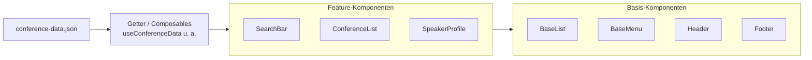
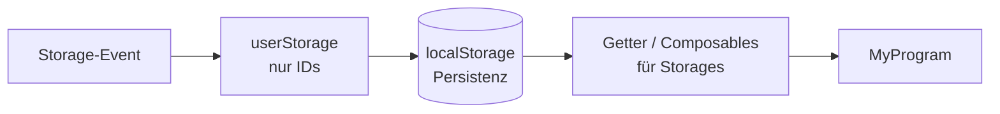
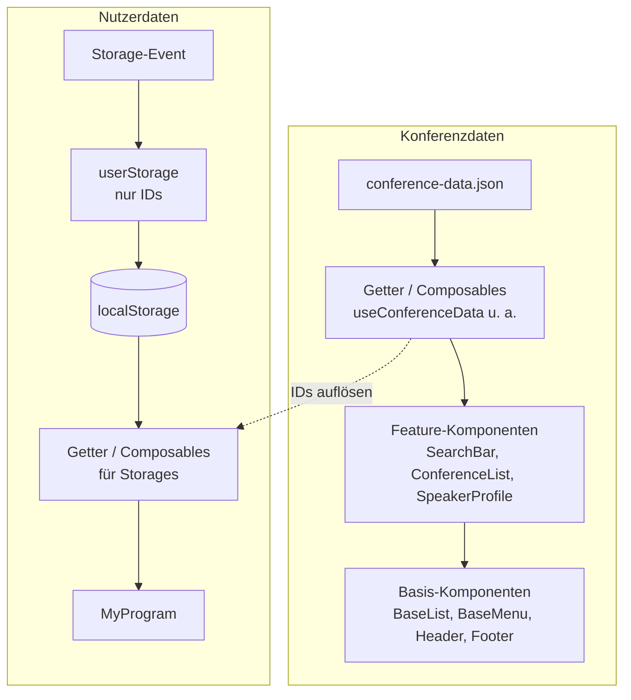

## State-Management Konzept

Grundsätzlich unterscheiden wir zwischen zwei Typen von Daten:
- Konferenzdaten: Sessions, Rooms, Speaker etc. sind read-only und kommen direct aus der JSON
- Nutzerdaten für "Mein Programm": Favoriten, Zeitplan etc. sind klein, können verändert werden und lokal im Browser gespeichert

Die Konferenzdaten werden in useConferenceData.js beim App-Start geladen und gespeichert. Somit müssen die Kompoenten
nicht selbstständig jedes mal die ganze JSON laden. Cache Speicher möglich. Die Nutzerdaten werden über den localStorage gespeichert, da diese veränderbar sind und wesendlich weniger enthalten
als die vollständigen Konferenzdaten.

### Datenstrukturierung

Die gespeicherten Konferenzdaten werden über Objekte strukturiert, somit werden Duplikate oder fehlerhafte Kopien verhindert.
Die Nutzerdaten laufen über IDs laufen und die Objekte werden nicht kopiert, da sie sonst veralten. Storage Funktionen speichern beide Daten auf unterscheidliche Wege.
Die Konferenzdaten sind ausschließlich read-only und werden nur geladen oder refreshed.
Die gespeicherten Nutzerdaten enthalten nur die IDs und etwaige Einstellungen, beispielsweise die Favoriten.

### Reaktivität

Möglichst effiziente Reaktivität ist besonders wichtig, da dies Speicher- und Rechenzeit einspart. Bei Aktualisierungen 
werden benötigte Daten ersetzt und neu angelegt (state.value = new State).
In den Filter Funktionen wird nur abgeleitet (durch computed) da sie nie auf den gespeicherten Zustand zugreifen.
Sie agieren nur als Getter, die Daten auslesen aber nicht verändern können. Die Komponent greifen auserdem nur auf kleine
Abschnitte des großen Storages zu, beispielsweise durch useSession(id) oder useFavorite(id). Somit muss nicht jedes mal
der gesamte Storage geladen werden und er wird nicht dekonstruiert.

## Sequenzdiagramm

## Konferenzdaten

## Nutzerdaten

## Gesamtübersicht

